# tienda talavera

**Alumno:** Omar Mendez · **Grupo:** GTID232

## Evidencias por ronda

### Ronda 2. Rumbo y ángulos

**ROJO**

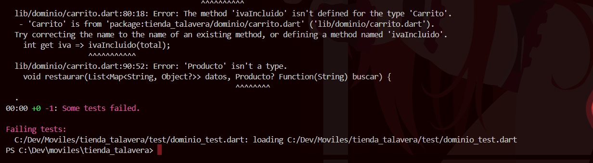

**VERDE**

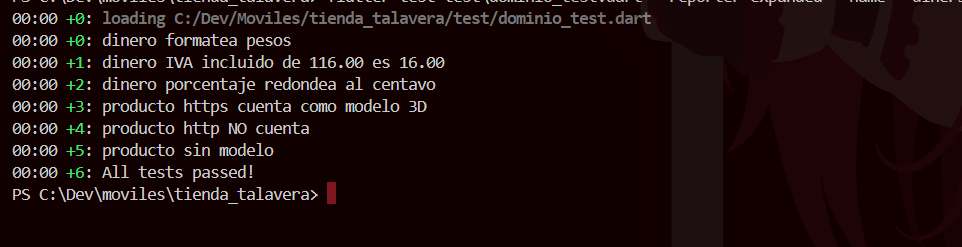

---

### Ronda 3. Campo de visión y formato

**ROJO**

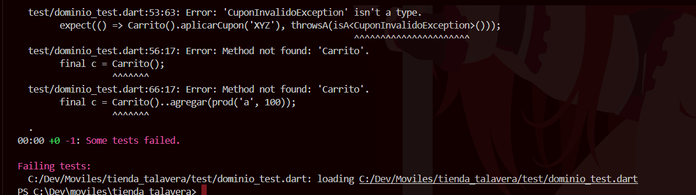

**VERDE**

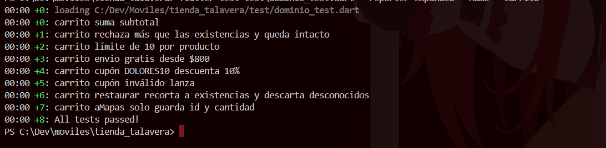

---

### Ronda 4. Motor de realidad aumentada

**ROJO**

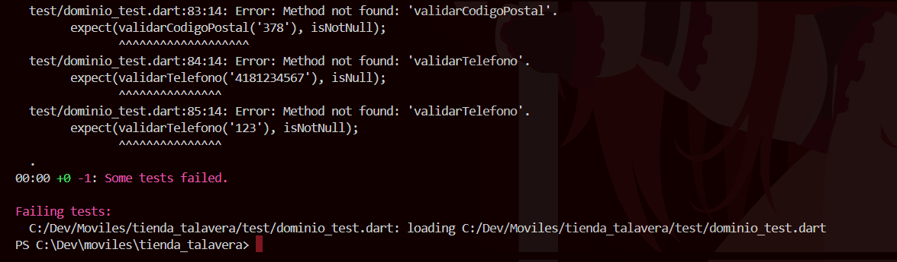

**VERDE**

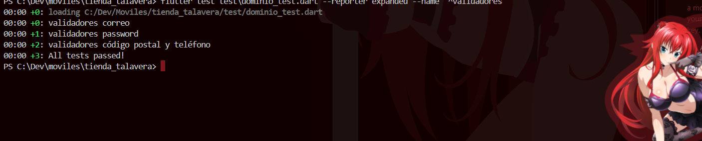

---

### Ronda 5. Pasaporte turístico

**ROJO**

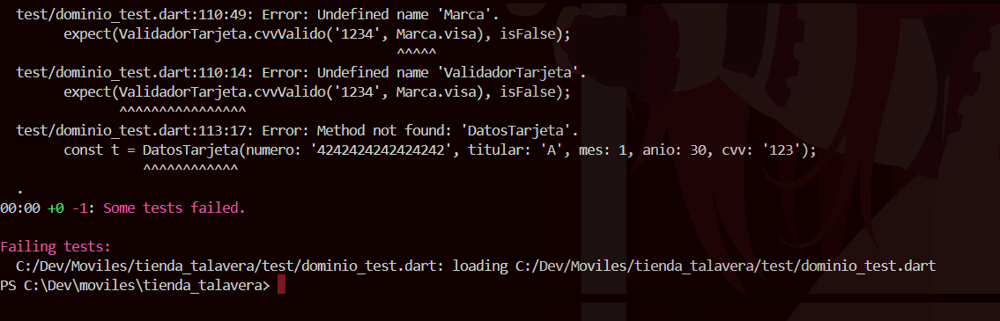

**VERDE**

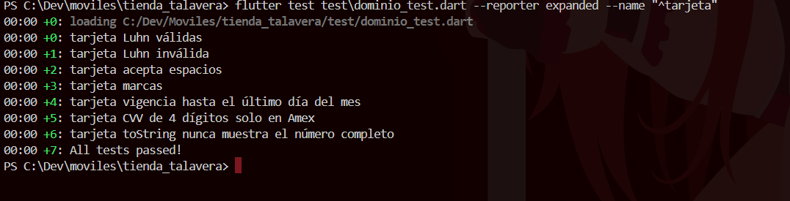

---

### Ronda 6

**ROJO**

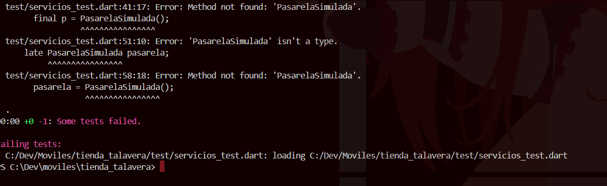

**VERDE**

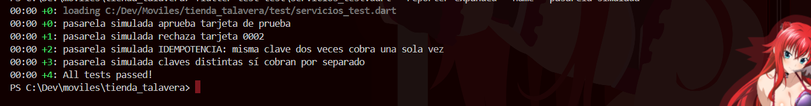

---

### Ronda 7

**ROJO**

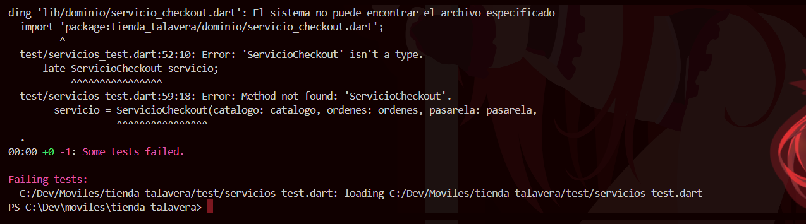

**VERDE**

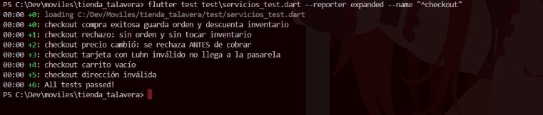

---

### Ronda 8

**ROJO**

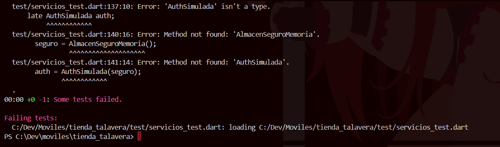

**VERDE**

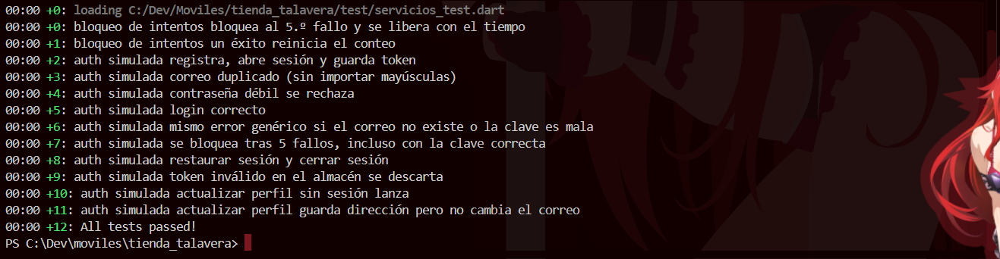

---

### Ronda 9

**ROJO**

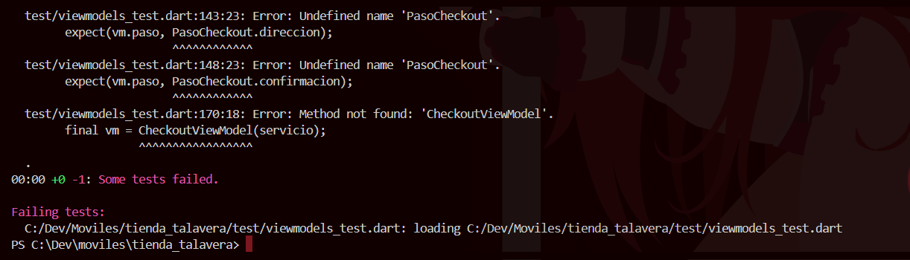

**VERDE**

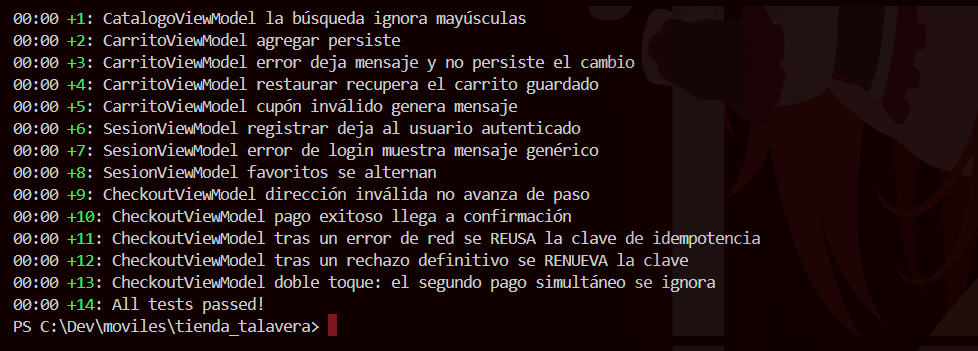

---

## Ejecución completa

Los 60 tests ejecutados en conjunto:

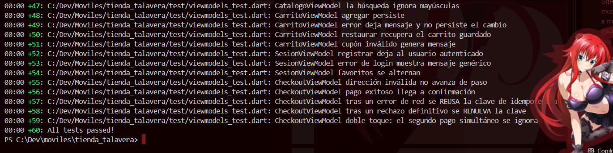

## Interfaz

Pantalla de inicio: 

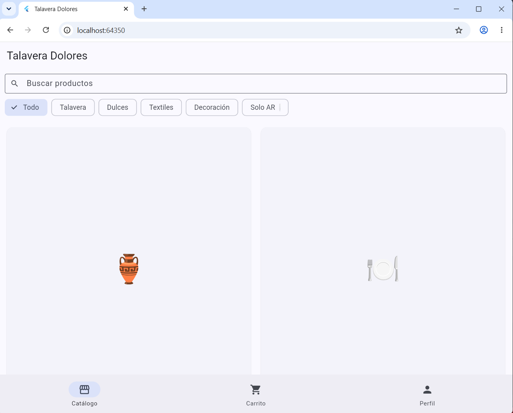